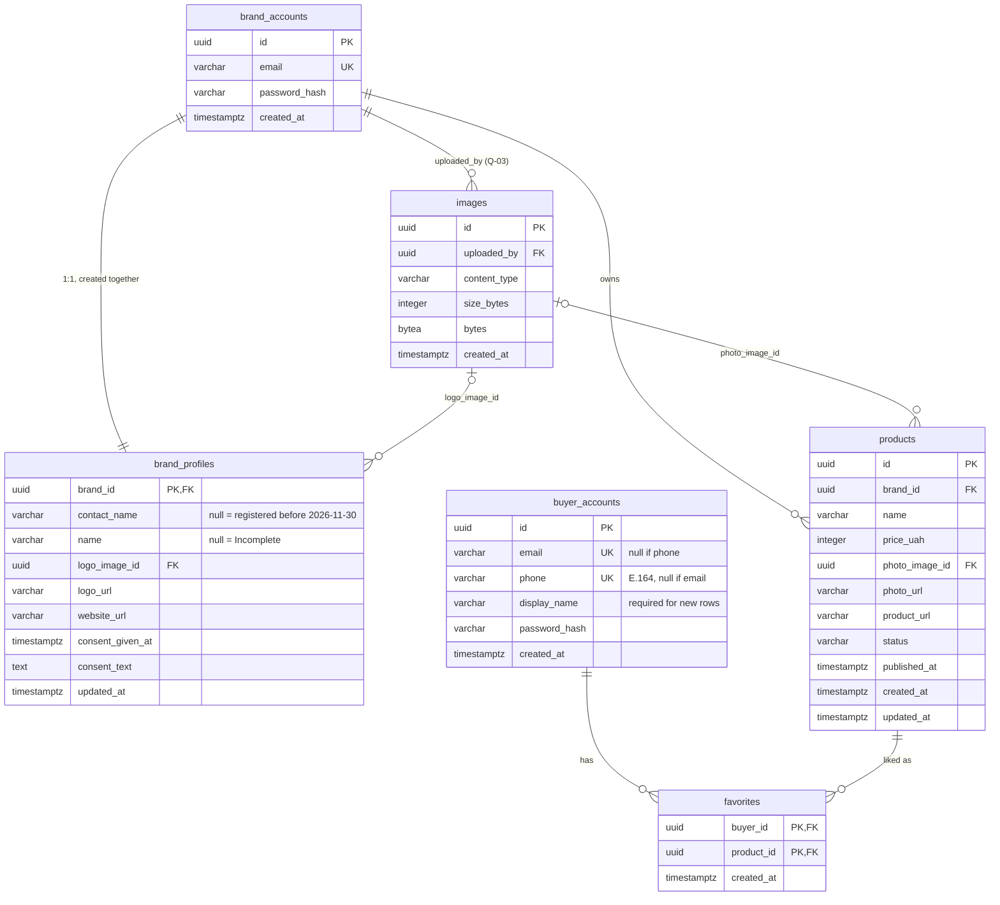

# FULLA — Data Model (MVP)

**Audience:** whoever writes the Flyway migrations and the `JdbcClient` repositories.
**Sources:** ADR-0004 (Postgres, conventions), ADR-0006 (accounts), ADR-0007 (images), ADR-0009 (concurrency SQL), ADR-0012 (favourites); domain rules in [`domain-model.md`](domain-model.md).
**Conventions (ADR-0004):** `snake_case` tables, `uuid` primary keys (`gen_random_uuid()`), `created_at`/`updated_at` as `timestamptz` (UTC), price as `integer` UAH, `bytea` for images (never JPA `@Lob`/`oid`). One migration per change, named `V20261103_1200__create_products.sql`.
**Not in the DB:** server sessions (in memory, ADR-0006) and the anonymous buyer session (browser localStorage, ADR-0008).

---

## 1. ER diagram

---

## 2. Tables

### 2.1. `brand_accounts` (US-21, US-21.1)

| Column | Type | Null | Constraint / default | Source |
|---|---|---|---|---|
| `id` | `uuid` | no | PK, `gen_random_uuid()` | ADR-0004 |
| `email` | `varchar(254)` | no | `UNIQUE`; `CHECK (email = lower(btrim(email)))`; `CHECK (email ~ '^[^@\s]+@[^@\s]+\.[^@\s]+$')` | US-21 CL, ADR-0009 |
| `password_hash` | `varchar(72)` | no | BCrypt string (60 chars) | ADR-0006 |
| `created_at` | `timestamptz` | no | `now()` | ADR-0004 |

### 2.2. `brand_profiles` (US-22.1, US-22.2)

| Column | Type | Null | Constraint / default | Source |
|---|---|---|---|---|
| `brand_id` | `uuid` | no | PK, FK → `brand_accounts(id)` | A-03 |
| `contact_name` | `varchar(50)` | yes | `CHECK (contact_name IS NULL OR char_length(btrim(contact_name)) BETWEEN 1 AND 50)` (`brand_profiles_contact_name_length`); no default | US-21 («Ваше імʼя», required at registration by Bean Validation `@DisplayName(required = true)`), editable in the profile («Контактна особа»); migration `V20261130_1200`. On the profile, not on `brand_accounts`: it is data the brand fills in and edits with the name and website, while `brand_accounts` keeps only the login data. Nullable without a default: brands registered before the migration keep `NULL` (a made-up value would look real); a profile save without it keeps the stored value, so they keep working until they fill it in. Not part of the derived state (§ domain-model 4.1) |
| `name` | `varchar(50)` | yes | `CHECK (name IS NULL OR char_length(btrim(name)) BETWEEN 2 AND 50)`; `NULL` = state Incomplete | US-22.1 CL |
| `logo_image_id` | `uuid` | yes | FK → `images(id)` | US-22.1 CL, ADR-0007 |
| `logo_url` | `varchar(2048)` | yes | `CHECK (logo_url IS NULL OR logo_url LIKE 'https://%')` | US-22.1 CL |
| `website_url` | `varchar(2048)` | yes | `CHECK (website_url IS NULL OR website_url LIKE 'https://%')` (`brand_profiles_website_url_https`); the domain rule is in Bean Validation (`@WebsiteUrl`) | US-21 (entered at registration, required there), US-22.1 (editable); never requested by the server (A-15); migration `V20261126_1200` |
| — | | | `CHECK (logo_image_id IS NULL OR logo_url IS NULL)` — at most one logo source | US-22.1 CL |
| `consent_given_at` | `timestamptz` | yes | `NULL` = no consent | US-22.2 S1, A-17 |
| `consent_text` | `text` | yes | exact text shown at the time of consent | A-17, NFR-14 |
| — | | | `CHECK ((consent_given_at IS NULL) = (consent_text IS NULL))` | A-17 |
| — | | | `CHECK (consent_given_at IS NULL OR name IS NOT NULL)` — no consent without a name | US-22.2 S1 Given |
| `created_at`, `updated_at` | `timestamptz` | no | `now()` | ADR-0004 |

The profile state is **derived**, not stored: `name IS NULL` → Incomplete; `consent_given_at IS NULL` → Active; else Consented.

### 2.3. `products` (US-25.1, US-26, US-31)

| Column | Type | Null | Constraint / default | Source |
|---|---|---|---|---|
| `id` | `uuid` | no | PK | ADR-0004 |
| `brand_id` | `uuid` | no | FK → `brand_accounts(id)` | INV-07 |
| `name` | `varchar(100)` | no | `CHECK (char_length(btrim(name)) BETWEEN 1 AND 100)` | US-25.1 CL |
| `price_uah` | `integer` | no | `CHECK (price_uah > 0 AND price_uah <= 1000000)` (upper bound: Q-11) | US-25.1 CL, A-13 |
| `photo_image_id` | `uuid` | yes | FK → `images(id)` | US-25.1 CL |
| `photo_url` | `varchar(2048)` | yes | `CHECK (photo_url IS NULL OR photo_url LIKE 'https://%')` | US-25.1 CL |
| — | | | `CHECK ((photo_image_id IS NULL) <> (photo_url IS NULL))` — exactly one photo source | US-25.1 CL, S2 |
| `product_url` | `varchar(2048)` | no | `CHECK (product_url ~* '^https?://[^/\s]+')` | US-26 CL |
| `status` | `varchar(10)` | no | `CHECK (status IN ('draft','published'))`, default `'draft'` | US-25.1 CL, US-31 CL |
| `published_at` | `timestamptz` | yes | `CHECK ((status = 'published') = (published_at IS NOT NULL))` | ADR-0009 |
| `created_at`, `updated_at` | `timestamptz` | no | `now()` | ADR-0004 |

No `brand_name` column: it is joined from `brand_profiles` (INV-03). No delete is ever issued (US-31 CL), so FKs need no `ON DELETE` rule.

Brand site import (ADR-0017, migration `V20261201_1200`), in addition to its columns from `V20261129_1200`:

| Column | Type | Null | Constraint / default | Source |
|---|---|---|---|---|
| `missing_since` | `timestamptz` | yes | `CHECK (missing_since IS NULL OR (brand_id IS NOT NULL AND external_id IS NOT NULL))` (`products_missing_only_brand_imported`); `CHECK (missing_since IS NULL OR status = 'draft')` (`products_missing_is_draft`) | «Немає на сайті»: set when a complete sync no longer lists the brand's imported card, cleared when it is listed again. The publish `UPDATE`s also require `missing_since IS NULL` |
| `removed_from_list_at` | `timestamptz` | yes | `CHECK (removed_from_list_at IS NULL OR missing_since IS NOT NULL)` (`products_removed_needs_missing`) | «Прибрати зі списку»: hidden from the cabinet list; cleared when the card is listed again. The list also leaves out cards with `missing_since` older than 30 days. The row is never deleted |

### 2.4. `images` (ADR-0007)

| Column | Type | Null | Constraint / default | Source |
|---|---|---|---|---|
| `id` | `uuid` | no | PK | ADR-0007 |
| `uploaded_by` | `uuid` | no | FK → `brand_accounts(id)` | Q-03 (proposal) |
| `content_type` | `varchar(20)` | no | `CHECK (content_type IN ('image/png','image/jpeg','image/webp'))` | US-22.1 CL |
| `size_bytes` | `integer` | no | `CHECK (size_bytes BETWEEN 1 AND 5242880)` | US-22.1 CL, US-25.1 CL |
| `bytes` | `bytea` | no | — | ADR-0004, ADR-0007 |
| `created_at` | `timestamptz` | no | `now()` | |

Rows are never updated (immutable cache). Orphans (replaced logos/photos) are kept; cleanup is postponed (ADR-0007).

### 2.5. `buyer_accounts` (US-02, US-03)

The columns and checks of `brand_accounts` (§2.1), and since migration `V20261127_1200` (ADR-0016) a buyer registers by email **or** phone, with an optional name. Separate table, so the same email may exist in both (ADR-0012).

| Column | Type | Null | Constraint / default | Source |
|---|---|---|---|---|
| `email` | `varchar(254)` | **yes** (was `no`) | `UNIQUE`; normalized and format CHECKs as before (they pass for NULL) | US-02 |
| `phone` | `varchar(16)` | yes | `UNIQUE`; `CHECK (phone ~ '^\+[1-9][0-9]{7,14}$')` — E.164, normalized by the server (`LoginId`) before every insert; not verified by SMS | ADR-0016 |
| `display_name` | `varchar(50)` | yes (column) | `CHECK (char_length(btrim(display_name)) BETWEEN 1 AND 50)`; since `V20261128_1200` also `CHECK (display_name IS NOT NULL) NOT VALID` — required for every new or changed row, while accounts created when the name was optional (NULL) are left as they are | ADR-0016 |
| — | | | `CHECK (email IS NOT NULL OR phone IS NOT NULL)` — at least one way to log in; both are allowed, so a phone can later be added to an email account | ADR-0016 |

Nothing else about a buyer is stored (NFR-19): the login, the password hash, the name and the liked product IDs.

### 2.6. `favorites` (US-02, US-03, US-09)

| Column | Type | Null | Constraint / default | Source |
|---|---|---|---|---|
| `buyer_id` | `uuid` | no | FK → `buyer_accounts(id)` | ADR-0012 |
| `product_id` | `uuid` | no | FK → `products(id)` | ADR-0012 |
| `created_at` | `timestamptz` | no | `now()` | |
| — | | | `PRIMARY KEY (buyer_id, product_id)` | INV-04 |

---

## 3. Unique constraints and indexes

| Table | Index | Kind | Serves |
|---|---|---|---|
| `brand_accounts` | `email` | `UNIQUE` | Registration race (US-21 S2, NFR-04); login lookup (US-21.1) |
| `buyer_accounts` | `email` | `UNIQUE` | Same for buyers (US-02 S2, US-03) |
| `favorites` | `(buyer_id, product_id)` | PK | No duplicates, `ON CONFLICT DO NOTHING`; `GET /api/me/favorites` by prefix |
| `products` | `(published_at, id) WHERE status = 'published'` | partial B-tree | `GET /api/feed` order (ADR-0009) |
| `products` | `(brand_id, created_at DESC)` | B-tree | Cabinet product list (US-25.1 S1, US-21.1 S1) |
| `images` | `uploaded_by` | B-tree | Ownership check when a card/profile references an image (Q-03) |

`GET /api/products?ids=…` uses the PK. At demo scale (A-20) nothing else is needed.

---

## 4. Invariants the schema cannot express

These are enforced in the service/repository code, **inside one transaction** where noted. Each must have a repository test on embedded Postgres (ADR-0011).

| # | Invariant | Why the schema can't | Where and how |
|---|---|---|---|
| T-1 | **Publish only with consent** (INV-02, US-22.2 CL, US-31 S2) | Cross-table condition at the moment of the change | One statement: `UPDATE products SET status='published', published_at=now(), updated_at=now() WHERE id=:id AND brand_id=:brand AND status='draft' AND EXISTS (SELECT 1 FROM brand_profiles WHERE brand_id=:brand AND consent_given_at IS NOT NULL)`. 0 rows → re-read the card and profile to choose `NOT_FOUND` / `INVALID_STATE` / `CONSENT_REQUIRED` (ADR-0009). |
| T-2 | **Create a card only with a brand name** (INV-11, US-22.1 CL, US-25.1 CL) | Cross-table condition | `INSERT INTO products (…) SELECT … FROM brand_profiles WHERE brand_id=:brand AND name IS NOT NULL`; 0 rows → `PROFILE_INCOMPLETE`. |
| T-3 | **Published cards are read-only** (INV-10, A-06) | A CHECK can't see the old row | `UPDATE products SET … WHERE id=:id AND brand_id=:brand AND status='draft'`; 0 rows → re-read → `NOT_FOUND` or `CARD_NOT_EDITABLE`. |
| T-4 | **Unpublish only from Published** (US-31 CL) | Transition, not a value | `UPDATE … SET status='draft', published_at=NULL WHERE id=:id AND brand_id=:brand AND status='published'`; 0 rows → `NOT_FOUND`/`INVALID_STATE`. |
| T-5 | **Consent is one-way for the brand** (INV-09, A-08) | Would need a trigger (we don't use triggers) | Profile `UPDATE` writes `consent_given_at = COALESCE(consent_given_at, :nowIfGiven)` and the same for `consent_text`; a request with `consentGiven=false` when already given → `CONSENT_LOCKED` before the update. |
| T-6 | **Operator consent withdrawal unpublishes everything** (R-P10, INV-02) | Two tables must change together | `ops` command, one transaction: `UPDATE brand_profiles SET consent_given_at=NULL, consent_text=NULL …; UPDATE products SET status='draft', published_at=NULL WHERE brand_id=:brand AND status='published'`. |
| T-7 | **Ownership** (INV-07) | The DB doesn't know who is calling | Every brand query has `AND brand_id = :sessionBrandId`; the brand ID comes from the session principal, never from the request body. |
| T-8 | **A card/profile may reference only the brand's own image** (Q-03) | FK checks existence, not owner | Before insert/update: `SELECT 1 FROM images WHERE id=:img AND uploaded_by=:brand`, else `NOT_FOUND`. |
| T-9 | **Registration creates account + empty profile together** (US-21 CL) | Two inserts | One transaction: insert `brand_accounts`, insert `brand_profiles(brand_id, contact_name, name, website_url)`. `DuplicateKeyException` (SQLState 23505) → `409 EMAIL_TAKEN_OR_INVALID`. Then log in. |
| T-10 | **Email normalized before insert/lookup** (ADR-0009) | The CHECK only rejects un-normalized values; it doesn't normalize | Service: `email.strip().toLowerCase(Locale.ROOT)` before every insert and login query. |
| T-11 | **Favourites merge ignores unknown IDs and is idempotent** (ADR-0012, US-03 S1) | The FK would *reject* the whole statement on one unknown ID | `INSERT INTO favorites (buyer_id, product_id) SELECT :buyer, p.id FROM products p WHERE p.id = ANY(:ids) ON CONFLICT DO NOTHING`, then `SELECT product_id … ORDER BY created_at`. Max 500 IDs per request (validated before SQL). |
| T-12 | **Exact formats** (US-21, US-02, US-26) | Regex CHECKs are coarse | Bean Validation is the authority: email `name@domain.tld`, `@HttpUrl` = `java.net.URI` parses, scheme `http`/`https`, non-empty host. The DB CHECKs are a safety net only. |
| T-13 | **Image type by magic bytes, size ≤ 5 MB** (ADR-0007) | The DB sees only the declared `content_type` | `images` service sniffs the first bytes (PNG `89 50 4E 47`, JPEG `FF D8 FF`, WEBP `RIFF….WEBP`) and sets `content_type` itself; multipart limit 5 MB. |
| T-14 | **Like/skip once per card on a device** (INV-05, US-10 S2) | Not server data at all | Frontend reducer in `features/feed/session.ts`, keyed by card ID. |

---

## 5. Planned: demo catalogue import (ADR-0014, Proposed, profile `dev` only)

> **Plan, not schema yet.** Nothing below exists until the migration is written and ADR-0014 is accepted. Until then, §1–§4 are the authority. Sections §1–§4 still describe the brand-facing model; the import adds a second, account-less way to own a card.

The server fetches three configured sources (Всі. Свої XML feed, One By One, Cher'17) **only in the `dev` profile**. This is an exception to A-15 ("the server never fetches brand URLs") for the local demo. Photos are never copied: imported cards use `photo_url` (brand `https://` URL).

### 5.1. New table `catalog_sources`

| Column | Type | Null | Constraint / default | Why |
|---|---|---|---|---|
| `id` | `uuid` | no | PK, `gen_random_uuid()` | ADR-0004 |
| `code` | `varchar(30)` | no | `UNIQUE`; `CHECK (code ~ '^[a-z0-9-]+$')` — `vsisvoi`, `onebyone`, `cher17` | Key used by the config in `application-dev.yml` |
| `base_url` | `varchar(2048)` | no | `CHECK (base_url LIKE 'https://%')` | Host allow-list for SSRF checks |
| `last_run_at` | `timestamptz` | yes | `NULL` = never ran | 6-hour gate survives restarts (T-18) |
| `last_run_status` | `varchar(10)` | yes | `CHECK (last_run_status IN ('ok','partial','skipped','failed'))` | Unpublish of missing items only after `ok` (T-16) |
| `logo_url` | `varchar(2048)` | yes | `CHECK (logo_url IS NULL OR logo_url LIKE 'https://%')` | Site logo URL for the brand tile, dev only; never the image itself (ADR-0014, ADR-0015; migration `V20261125_1200`) |
| `created_at` | `timestamptz` | no | `now()` | |

Rows are inserted by the importer on first start (`INSERT … ON CONFLICT (code) DO NOTHING`), not by the migration, so the migration contains no site URLs.

### 5.2. New table `source_brands` — brands without accounts

| Column | Type | Null | Constraint / default | Why |
|---|---|---|---|---|
| `id` | `uuid` | no | PK | |
| `source_id` | `uuid` | no | FK → `catalog_sources(id)` | A brand name is unique only within its source |
| `name` | `varchar(50)` | no | `CHECK (char_length(btrim(name)) BETWEEN 2 AND 50)` — same rule as `brand_profiles.name` | `brandName` on the card (INV-03: still joined, never stored on the card) |
| `created_at` | `timestamptz` | no | `now()` | |
| — | | | `UNIQUE (source_id, name)`; `UNIQUE (id, source_id)` (target for the composite FK below) | |

One row for One By One ("One By One") and one for Cher'17 ("CHER'17"). Всі. Свої is a marketplace, so it has one row per `g:brand` value (SMPL underwear, Barricade, Garrt…). A missing or implausible `g:brand` (equal to the product type, e.g. «Капелюх») maps to the fallback name «Всі. Свої». Source brands have no email, password, profile, logo or consent row; they can't log in.

### 5.3. Changes to `products`

| Column | Type | Null | Constraint | Filled by |
|---|---|---|---|---|
| `brand_id` | `uuid` | **yes** (was `no`) | — | Brand cabinet only |
| `source_id` | `uuid` | yes | FK → `catalog_sources(id)` | Importer |
| `source_brand_id` | `uuid` | yes | FK `(source_brand_id, source_id)` → `source_brands(id, source_id)` (the brand must belong to the same source) | Importer |
| `external_id` | `varchar(100)` | yes | `UNIQUE (source_id, external_id)` | Importer: Всі. Свої `g:item_group_id`; One By One / Cher'17 canonical product URL path |
| `last_synced_at` | `timestamptz` | yes | — | Importer, every successful upsert |
| `sizes` | `jsonb` | yes | `CHECK (sizes IS NULL OR jsonb_typeof(sizes) = 'array')`; shape `[{"label":"M","available":true}]`, in site order | Importer (Всі. Свої: one feed item per size; others: HTML via Jsoup) |
| `colors` | `jsonb` | yes | `CHECK (colors IS NULL OR jsonb_typeof(colors) = 'array')`; shape `[{"name":"бежевий","hex":"#D9C4A5"}]`; `hex` is `null` when the name isn't in the importer's fixed name → hex table | Importer |
| `material` | `varchar(500)` | yes | plain text, e.g. «Віскоза 95%, Еластан 5%» | Importer |
| `description` | `text` | yes | `CHECK (description IS NULL OR char_length(description) <= 5000)`; **plain text only** (HTML stripped by Jsoup) | Importer |

New table-level checks:
- `CHECK ((brand_id IS NULL) <> (source_brand_id IS NULL))` — a card has exactly one owner: an account brand or a source brand.
- `CHECK ((source_id IS NULL) = (source_brand_id IS NULL) AND (source_id IS NULL) = (external_id IS NULL) AND (source_id IS NULL) = (last_synced_at IS NULL))` — import columns are all set or all empty.
- `CHECK (source_id IS NULL OR photo_url IS NOT NULL)` — imported cards never use `images` (no copies, ADR-0007).

Unchanged: `name` 1–100 chars (the importer trims longer names at a word boundary), `price_uah` 1…1 000 000 (rounded to whole UAH; an item outside the range is skipped), `product_url` as given by the source (no UTM; the client adds it), `status`/`published_at` checks, the feed index. Sizes, colours, material and description are **not** returned by any endpoint (US-13…US-15 are Out of Scope, `api.md`).

`brandName` for every read = `COALESCE(bp.name, sb.name)` via `LEFT JOIN brand_profiles bp ON bp.brand_id = p.brand_id LEFT JOIN source_brands sb ON sb.id = p.source_brand_id` (INV-03 still holds).

### 5.4. New invariants (code-enforced)

| # | Invariant | Where and how |
|---|---|---|
| T-15 | **Imported card upsert** goes through `ProductService` (only `ua.fulla.products` changes status). | One statement per item: `INSERT … ON CONFLICT (source_id, external_id) DO UPDATE SET name, price_uah, photo_url, product_url, sizes, colors, material, description, last_synced_at, updated_at`. Available item → `status='published'`, `published_at = COALESCE(products.published_at, now())` (an existing card keeps its feed position). Not available (no size in stock / `OutOfStock`) → `status='draft'`, `published_at=NULL`. The conflict target only matches rows with `source_id`, so brand cards are never touched. |
| T-16 | **Items gone from the source are unpublished, never deleted.** | Only after a run with status `ok`: `UPDATE products SET status='draft', published_at=NULL, updated_at=now() WHERE source_id=:src AND status='published' AND NOT (external_id = ANY(:seenIds))`. Skipped after `partial`/`failed`, so a network error doesn't empty the feed. |
| T-17 | **Brand cabinet can't see or change imported cards.** | Already true: every brand query filters `brand_id = :sessionBrandId` (T-7), and imported rows have `brand_id IS NULL`. Cover with a repository test. |
| T-18 | **At most one run per source per 6 hours**, even across restarts. | The run is claimed by a conditional update: `UPDATE catalog_sources SET last_run_at=now() WHERE code=:code AND (last_run_at IS NULL OR last_run_at < now() - interval '6 hours')`; 0 rows → skip (ADR-0009 style, no check-then-act). |

Exceptions, valid **only** for rows with `source_id`: T-1 (publish needs consent) and T-2 (create needs a brand name in `brand_profiles`) don't apply; T-3 (published = read-only) binds brand edits, not the sync in T-15.

### 5.5. Migration plan (not written yet)

One file, e.g. `V20261118_1000__add_catalog_import.sql` (timestamp chosen when it is written), together with the repository code and tests (§4.3 of `CLAUDE.md`):

1. `CREATE TABLE catalog_sources` (§5.1).
2. `CREATE TABLE source_brands` (§5.2) with `UNIQUE (source_id, name)` and `UNIQUE (id, source_id)`.
3. `ALTER TABLE products ALTER COLUMN brand_id DROP NOT NULL`.
4. `ALTER TABLE products ADD COLUMN` `source_id`, `source_brand_id`, `external_id`, `last_synced_at`, `sizes`, `colors`, `material`, `description`.
5. Add the FKs (`source_id`, composite `(source_brand_id, source_id)`), `UNIQUE (source_id, external_id)` and the three checks from §5.3. Existing rows pass all of them (brand cards: `brand_id` set, import columns `NULL`).
6. No index changes: `products_feed_idx` serves both kinds of cards; the unique constraint indexes `(source_id, external_id)`.

Tests on embedded Postgres: upsert is idempotent (same item twice → one row); price change updates the row and keeps `published_at`; out-of-stock → draft; missing after an `ok` run → draft, after `partial` → unchanged; brand `GET /api/brand/products` never lists imported cards; the 6-hour claim lets only one of two parallel claims through; each new check rejects a bad row.
