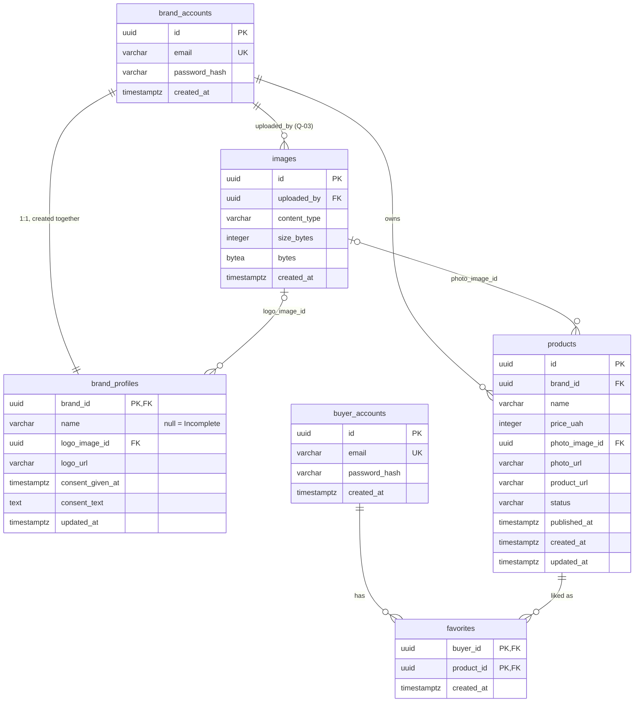

# FULLA — Data Model (MVP)

**Audience:** whoever writes the Flyway migrations and the `JdbcClient` repositories.
**Sources:** ADR-0004 (Postgres, conventions), ADR-0006 (accounts), ADR-0007 (images), ADR-0009 (concurrency SQL), ADR-0012 (favourites); domain rules in [`domain-model.md`](domain-model.md).
**Conventions (ADR-0004):** `snake_case` tables, `uuid` primary keys (`gen_random_uuid()`), `created_at`/`updated_at` as `timestamptz` (UTC), price as `integer` UAH, `bytea` for images (never JPA `@Lob`/`oid`). One migration per change, named `V20261103_1200__create_products.sql`.
**Not in the DB:** server sessions (in memory, ADR-0006) and the anonymous buyer session (browser localStorage, ADR-0008).

---

## 1. ER diagram

---

## 2. Tables

### 2.1. `brand_accounts` (US-21, US-21.1)

| Column | Type | Null | Constraint / default | Source |
|---|---|---|---|---|
| `id` | `uuid` | no | PK, `gen_random_uuid()` | ADR-0004 |
| `email` | `varchar(254)` | no | `UNIQUE`; `CHECK (email = lower(btrim(email)))`; `CHECK (email ~ '^[^@\s]+@[^@\s]+\.[^@\s]+$')` | US-21 CL, ADR-0009 |
| `password_hash` | `varchar(72)` | no | BCrypt string (60 chars) | ADR-0006 |
| `created_at` | `timestamptz` | no | `now()` | ADR-0004 |

### 2.2. `brand_profiles` (US-22.1, US-22.2)

| Column | Type | Null | Constraint / default | Source |
|---|---|---|---|---|
| `brand_id` | `uuid` | no | PK, FK → `brand_accounts(id)` | A-03 |
| `name` | `varchar(50)` | yes | `CHECK (name IS NULL OR char_length(btrim(name)) BETWEEN 2 AND 50)`; `NULL` = state Incomplete | US-22.1 CL |
| `logo_image_id` | `uuid` | yes | FK → `images(id)` | US-22.1 CL, ADR-0007 |
| `logo_url` | `varchar(2048)` | yes | `CHECK (logo_url IS NULL OR logo_url LIKE 'https://%')` | US-22.1 CL |
| — | | | `CHECK (logo_image_id IS NULL OR logo_url IS NULL)` — at most one logo source | US-22.1 CL |
| `consent_given_at` | `timestamptz` | yes | `NULL` = no consent | US-22.2 S1, A-17 |
| `consent_text` | `text` | yes | exact text shown at the time of consent | A-17, NFR-14 |
| — | | | `CHECK ((consent_given_at IS NULL) = (consent_text IS NULL))` | A-17 |
| — | | | `CHECK (consent_given_at IS NULL OR name IS NOT NULL)` — no consent without a name | US-22.2 S1 Given |
| `created_at`, `updated_at` | `timestamptz` | no | `now()` | ADR-0004 |

The profile state is **derived**, not stored: `name IS NULL` → Incomplete; `consent_given_at IS NULL` → Active; else Consented.

### 2.3. `products` (US-25.1, US-26, US-31)

| Column | Type | Null | Constraint / default | Source |
|---|---|---|---|---|
| `id` | `uuid` | no | PK | ADR-0004 |
| `brand_id` | `uuid` | no | FK → `brand_accounts(id)` | INV-07 |
| `name` | `varchar(100)` | no | `CHECK (char_length(btrim(name)) BETWEEN 1 AND 100)` | US-25.1 CL |
| `price_uah` | `integer` | no | `CHECK (price_uah > 0 AND price_uah <= 1000000)` (upper bound: Q-11) | US-25.1 CL, A-13 |
| `photo_image_id` | `uuid` | yes | FK → `images(id)` | US-25.1 CL |
| `photo_url` | `varchar(2048)` | yes | `CHECK (photo_url IS NULL OR photo_url LIKE 'https://%')` | US-25.1 CL |
| — | | | `CHECK ((photo_image_id IS NULL) <> (photo_url IS NULL))` — exactly one photo source | US-25.1 CL, S2 |
| `product_url` | `varchar(2048)` | no | `CHECK (product_url ~* '^https?://[^/\s]+')` | US-26 CL |
| `status` | `varchar(10)` | no | `CHECK (status IN ('draft','published'))`, default `'draft'` | US-25.1 CL, US-31 CL |
| `published_at` | `timestamptz` | yes | `CHECK ((status = 'published') = (published_at IS NOT NULL))` | ADR-0009 |
| `created_at`, `updated_at` | `timestamptz` | no | `now()` | ADR-0004 |

No `brand_name` column: it is joined from `brand_profiles` (INV-03). No delete is ever issued (US-31 CL), so FKs need no `ON DELETE` rule.

### 2.4. `images` (ADR-0007)

| Column | Type | Null | Constraint / default | Source |
|---|---|---|---|---|
| `id` | `uuid` | no | PK | ADR-0007 |
| `uploaded_by` | `uuid` | no | FK → `brand_accounts(id)` | Q-03 (proposal) |
| `content_type` | `varchar(20)` | no | `CHECK (content_type IN ('image/png','image/jpeg','image/webp'))` | US-22.1 CL |
| `size_bytes` | `integer` | no | `CHECK (size_bytes BETWEEN 1 AND 5242880)` | US-22.1 CL, US-25.1 CL |
| `bytes` | `bytea` | no | — | ADR-0004, ADR-0007 |
| `created_at` | `timestamptz` | no | `now()` | |

Rows are never updated (immutable cache). Orphans (replaced logos/photos) are kept; cleanup is postponed (ADR-0007).

### 2.5. `buyer_accounts` (US-02, US-03)

Same columns and checks as `brand_accounts` (§2.1). Separate table, so the same email may exist in both (ADR-0012).

### 2.6. `favorites` (US-02, US-03, US-09)

| Column | Type | Null | Constraint / default | Source |
|---|---|---|---|---|
| `buyer_id` | `uuid` | no | FK → `buyer_accounts(id)` | ADR-0012 |
| `product_id` | `uuid` | no | FK → `products(id)` | ADR-0012 |
| `created_at` | `timestamptz` | no | `now()` | |
| — | | | `PRIMARY KEY (buyer_id, product_id)` | INV-04 |

---

## 3. Unique constraints and indexes

| Table | Index | Kind | Serves |
|---|---|---|---|
| `brand_accounts` | `email` | `UNIQUE` | Registration race (US-21 S2, NFR-04); login lookup (US-21.1) |
| `buyer_accounts` | `email` | `UNIQUE` | Same for buyers (US-02 S2, US-03) |
| `favorites` | `(buyer_id, product_id)` | PK | No duplicates, `ON CONFLICT DO NOTHING`; `GET /api/me/favorites` by prefix |
| `products` | `(published_at, id) WHERE status = 'published'` | partial B-tree | `GET /api/feed` order (ADR-0009) |
| `products` | `(brand_id, created_at DESC)` | B-tree | Cabinet product list (US-25.1 S1, US-21.1 S1) |
| `images` | `uploaded_by` | B-tree | Ownership check when a card/profile references an image (Q-03) |

`GET /api/products?ids=…` uses the PK. At demo scale (A-20) nothing else is needed.

---

## 4. Invariants the schema cannot express

These are enforced in the service/repository code, **inside one transaction** where noted. Each must have a repository test on embedded Postgres (ADR-0011).

| # | Invariant | Why the schema can't | Where and how |
|---|---|---|---|
| T-1 | **Publish only with consent** (INV-02, US-22.2 CL, US-31 S2) | Cross-table condition at the moment of the change | One statement: `UPDATE products SET status='published', published_at=now(), updated_at=now() WHERE id=:id AND brand_id=:brand AND status='draft' AND EXISTS (SELECT 1 FROM brand_profiles WHERE brand_id=:brand AND consent_given_at IS NOT NULL)`. 0 rows → re-read the card and profile to choose `NOT_FOUND` / `INVALID_STATE` / `CONSENT_REQUIRED` (ADR-0009). |
| T-2 | **Create a card only with a brand name** (INV-11, US-22.1 CL, US-25.1 CL) | Cross-table condition | `INSERT INTO products (…) SELECT … FROM brand_profiles WHERE brand_id=:brand AND name IS NOT NULL`; 0 rows → `PROFILE_INCOMPLETE`. |
| T-3 | **Published cards are read-only** (INV-10, A-06) | A CHECK can't see the old row | `UPDATE products SET … WHERE id=:id AND brand_id=:brand AND status='draft'`; 0 rows → re-read → `NOT_FOUND` or `CARD_NOT_EDITABLE`. |
| T-4 | **Unpublish only from Published** (US-31 CL) | Transition, not a value | `UPDATE … SET status='draft', published_at=NULL WHERE id=:id AND brand_id=:brand AND status='published'`; 0 rows → `NOT_FOUND`/`INVALID_STATE`. |
| T-5 | **Consent is one-way for the brand** (INV-09, A-08) | Would need a trigger (we don't use triggers) | Profile `UPDATE` writes `consent_given_at = COALESCE(consent_given_at, :nowIfGiven)` and the same for `consent_text`; a request with `consentGiven=false` when already given → `CONSENT_LOCKED` before the update. |
| T-6 | **Operator consent withdrawal unpublishes everything** (R-P10, INV-02) | Two tables must change together | `ops` command, one transaction: `UPDATE brand_profiles SET consent_given_at=NULL, consent_text=NULL …; UPDATE products SET status='draft', published_at=NULL WHERE brand_id=:brand AND status='published'`. |
| T-7 | **Ownership** (INV-07) | The DB doesn't know who is calling | Every brand query has `AND brand_id = :sessionBrandId`; the brand ID comes from the session principal, never from the request body. |
| T-8 | **A card/profile may reference only the brand's own image** (Q-03) | FK checks existence, not owner | Before insert/update: `SELECT 1 FROM images WHERE id=:img AND uploaded_by=:brand`, else `NOT_FOUND`. |
| T-9 | **Registration creates account + empty profile together** (US-21 CL) | Two inserts | One transaction: insert `brand_accounts`, insert `brand_profiles(brand_id)`. `DuplicateKeyException` (SQLState 23505) → `409 EMAIL_TAKEN_OR_INVALID`. Then log in. |
| T-10 | **Email normalized before insert/lookup** (ADR-0009) | The CHECK only rejects un-normalized values; it doesn't normalize | Service: `email.strip().toLowerCase(Locale.ROOT)` before every insert and login query. |
| T-11 | **Favourites merge ignores unknown IDs and is idempotent** (ADR-0012, US-03 S1) | The FK would *reject* the whole statement on one unknown ID | `INSERT INTO favorites (buyer_id, product_id) SELECT :buyer, p.id FROM products p WHERE p.id = ANY(:ids) ON CONFLICT DO NOTHING`, then `SELECT product_id … ORDER BY created_at`. Max 500 IDs per request (validated before SQL). |
| T-12 | **Exact formats** (US-21, US-02, US-26) | Regex CHECKs are coarse | Bean Validation is the authority: email `name@domain.tld`, `@HttpUrl` = `java.net.URI` parses, scheme `http`/`https`, non-empty host. The DB CHECKs are a safety net only. |
| T-13 | **Image type by magic bytes, size ≤ 5 MB** (ADR-0007) | The DB sees only the declared `content_type` | `images` service sniffs the first bytes (PNG `89 50 4E 47`, JPEG `FF D8 FF`, WEBP `RIFF….WEBP`) and sets `content_type` itself; multipart limit 5 MB. |
| T-14 | **Like/skip once per card on a device** (INV-05, US-10 S2) | Not server data at all | Frontend reducer in `features/feed/session.ts`, keyed by card ID. |
