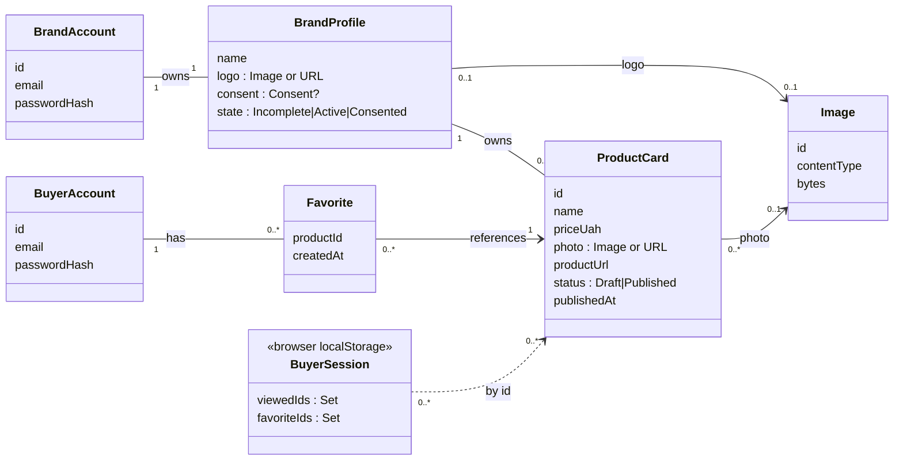
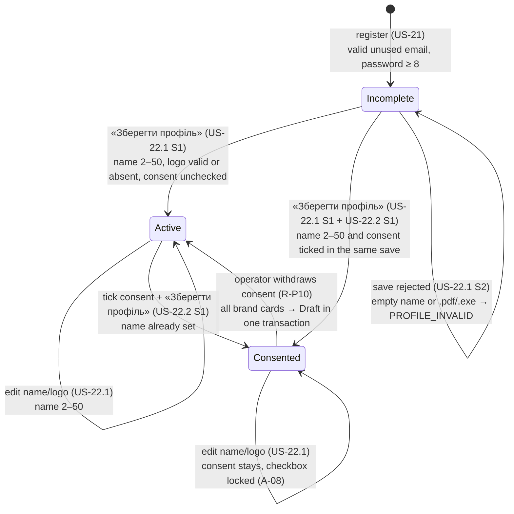
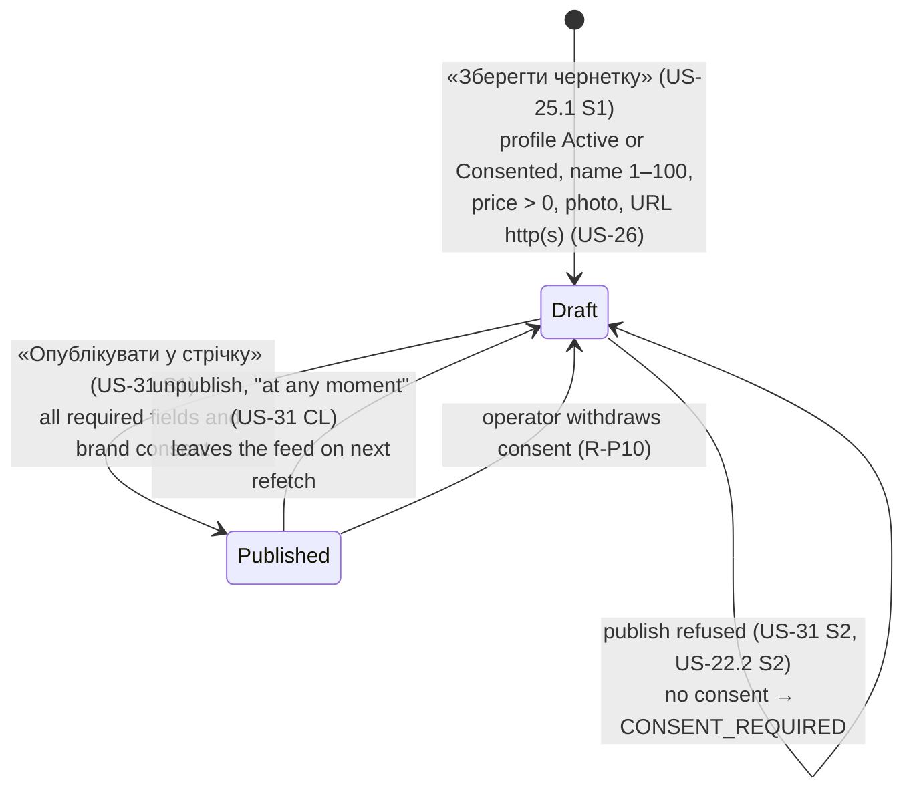
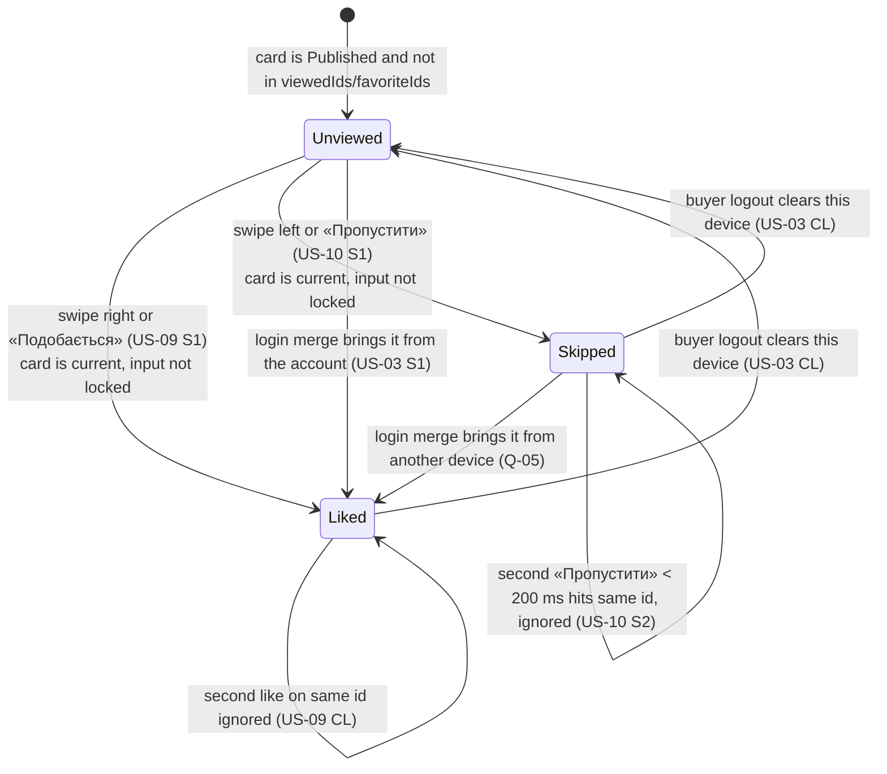

# FULLA — Domain Model (MVP)

**Audience:** everyone who writes code or tests.
**Sources:** acceptance criteria of the MVP stories (`US-xx CL` = business-rule checklist, `S1`/`S2` = scenarios), [`requirements-digest.md`](../analysis/requirements-digest.md) (BR-, INV-, A- IDs), ADR-0006/0007/0009/0012.
**Rule of this document:** every constraint names its source. A constraint marked **(proposal)** is not in any story or ADR. It is listed in [`overview.md` §9](overview.md#9-open-questions) and must not be treated as agreed.

---

## 1. Entity map

Server-side entities: everything except `BuyerSession` and `CardImpression`, which live only in the buyer's browser (A-09, ADR-0008).

---

## 2. Entities and attributes

### 2.1. BrandAccount

| Attribute | Constraint | Source |
|---|---|---|
| `id` | UUID, generated | ADR-0004 |
| `email` | Required. Format `name@domain.tld` (e.g. `info@brand.ua`); a string without `@` is invalid. Stored normalized: trimmed, lower-case. Unique among **brands** (a buyer may use the same email). Max 254 chars **(proposal, RFC 5321)**. | US-21 CL, S2; ADR-0009; ADR-0012 |
| `password` | Required, **≥ 8 characters**; ≤ 72 **(proposal, Q-11: BCrypt limit)**. Never stored; only a BCrypt hash. | US-21 CL; NFR-03; ADR-0006 |
| — | One account = one brand = one profile. No email/password change, no deletion, no password reset in the UI (operator command only). | A-03; US-21.1 CL; ADR-0006 |

### 2.2. BrandProfile (1:1 with BrandAccount)

| Attribute | Constraint | Source |
|---|---|---|
| `name` | Required on every save, **2–50 characters** after trimming. Empty until the first save. | US-22.1 CL, S2 |
| `logo` | **Optional.** Either an uploaded image (PNG/JPG/WEBP, ≤ 5 MB) **or** an image URL starting with `https://`, never both. `.pdf`, `.exe` and other types are rejected. Shown only in the cabinet header, never on buyer cards. | US-22.1 CL, S2; ADR-0007 |
| `consent` | A checkbox with the exact text «Я надаю згоду платформі FULLA на демонстрацію логотипа, фотографій та інформації про товари мого бренду». Unchecked by default; needs an explicit action. Recorded as **timestamp + the exact text shown**. | US-22.2 CL, S1; A-17; NFR-14 |
| `consent` (withdrawal) | Cannot be unchecked in the UI once saved. Only the operator can withdraw it, and withdrawal unpublishes all the brand's cards in the same transaction. | A-08; R-P10 |

### 2.3. ProductCard

| Attribute | Constraint | Source |
|---|---|---|
| `id` | UUID | ADR-0004 |
| `brand` | The owning brand; set from the session, never from the request. | INV-07; ADR-0006 |
| `name` | Required, **1–100 characters**. Displayed truncated with an ellipsis after 2 lines. | US-25.1 CL; US-08.2 CL |
| `priceUah` | Required. **Positive whole number** of hryvnias; `-500`, `0` and text are rejected. Upper bound 1 000 000 **(proposal, Q-11)**. Displayed as `2400 грн` (no thousands separator) in the feed, «Вподобане» and preview. | US-25.1 CL, S2; US-08.2 CL; A-13 |
| `photo` | Required. Upload PNG/JPG/WEBP ≤ 5 MB **or** an image URL starting with `https://`, exactly one of the two. | US-25.1 CL; ADR-0007 |
| `productUrl` | Required. Must start with `http://` or `https://` and parse as a URI with a non-empty host. Format only; FULLA never fetches it. Stored exactly as entered (no UTM). | US-26 CL, S2; A-15; ADR-0009 |
| `brandName` | **Not stored on the card.** Always the current `BrandProfile.name`. | US-22.1 CL; US-25.1 CL; INV-03 |
| `status` | `Draft` («Чернетка») or `Published` («Опубліковано»). | US-25.1 CL; US-31 CL |
| `publishedAt` | Set on each Draft → Published; empty while Draft. Defines the feed order. | ADR-0009 |
| — | No deletion. Unpublishing is the only way to remove a card from the feed. | US-31 CL |

### 2.4. Image

| Attribute | Constraint | Source |
|---|---|---|
| `id` | UUID; an image is never changed, only replaced by a new ID. | ADR-0007 |
| `contentType` | `image/png`, `image/jpeg` or `image/webp`, decided by **magic bytes**, not by file name or client header. | ADR-0007; US-22.1 S2 |
| `bytes` | ≤ 5 MB (5 242 880 bytes). The browser resizes to ≤ 1600 px before upload. | US-22.1 CL; US-25.1 CL; ADR-0007 |
| `uploadedBy` | The brand that uploaded it **(proposal, Q-03)**. | — |

### 2.5. BuyerAccount (optional)

| Attribute | Constraint | Source |
|---|---|---|
| `email` | Required, `name@domain.tld` (e.g. `name@mail.com`), normalized, unique among **buyers**. | US-02 CL, S2 |
| `password` | Required, ≥ 8 characters (≤ 72, proposal Q-11); BCrypt hash only. | US-02 CL; NFR-03 |
| — | The form states: «Ми зберігаємо лише ваш email і список вподобаних товарів». Nothing else about the buyer is stored. | US-02 CL; NFR-19 |

### 2.6. Favorite (registered buyers, server side)

| Attribute | Constraint | Source |
|---|---|---|
| `buyer`, `product` | A pair; each product at most once per buyer. | US-02 CL; US-03 CL; INV-04 |
| — | **Append-only**: no removal in the MVP (US-17 is Out of Scope). | ADR-0012 |
| — | A reference, not a snapshot: «Вподобане» shows the card's **current** name, brand, price; an unpublished card stays listed with an inactive button. | A-11; ADR-0009 |

### 2.7. BuyerSession (browser, per device)

| Attribute | Constraint | Source |
|---|---|---|
| `viewedIds` | IDs of cards liked or skipped on this device. Survives reload, return to start, browser restart; shared between tabs. | US-01.2 S2; US-09 S2; A-09 |
| `favoriteIds` | Set of liked IDs (no duplicates). For a logged-in buyer it is the instant local copy of the server set. | US-09 CL; ADR-0012 |
| — | Logout clears both sets on this device. | US-03 CL |

### 2.8. Value objects

| Name | Rule | Source |
|---|---|---|
| **Outbound link** | `withUtm(productUrl)`: add `utm_source=fulla`; with `&` if a query exists (`…?id=42&utm_source=fulla`); before any `#fragment`; unchanged if `utm_source` is already present. Opened in a new tab, `rel="noopener noreferrer"`. | US-19 CL; US-32 CL, S1, S2; A-16; NFR-11 |
| **Price display** | `<priceUah> грн`, digits without separators. | US-08.2 CL |
| **Feed** | All Published cards ordered by `publishedAt, id`; the buyer sees the first card whose ID is in neither `viewedIds` nor `favoriteIds`. | INV-01; A-10; ADR-0009 |

---

## 3. Invariants

| ID | Invariant | Source | Enforced by |
|---|---|---|---|
| INV-01 | The buyer feed contains **only** Published cards. | US-25.1 CL; US-31 CL | `GET /api/feed` query |
| INV-02 | Every Published card has name, price > 0, photo, http(s) URL, and its brand has a name **and** consent. | US-22.1 CL; US-22.2 CL; US-31 CL | DB checks + conditional publish `UPDATE` |
| INV-03 | The brand name on a card always equals the current profile name. | US-22.1 CL | not stored on the card (join) |
| INV-04 | A product is in a buyer's favourites at most once (browser set and server table). | US-09 CL; US-02 CL; US-03 S1 | JS `Set`; `PRIMARY KEY (buyer_id, product_id)` |
| INV-05 | On one device, each card is liked or skipped at most once; liked ⊂ viewed. *Skipped ∩ Favorites = ∅ holds only until a login merge (Q-05).* | US-09 CL; US-10 CL, S2 | session reducer keyed by card ID |
| INV-06 | FULLA never handles orders, payment, delivery address or size. | US-32 CL | no such fields or endpoints exist |
| INV-07 | A brand sees and changes only its own profile, cards and images. | US-25.1 S1; US-21.1 | every query filters by the session's brand ID |
| INV-08 | Email is unique per account type, also under concurrent registration. | US-21 CL; US-02 CL; NFR-04 | unique index on the normalized email |
| INV-09 | Consent, once given, is never cleared by the brand. | A-08 | service rule (no DB trigger) |
| INV-10 | A Published card's fields never change; only its status can. | A-06 | `UPDATE … WHERE status = 'draft'` |
| INV-11 | A card can be created only when the brand has a name. | US-22.1 CL; US-25.1 CL | service check in the insert transaction |
| INV-12 | No buyer step is preceded by registration; every buyer function works anonymously. | US-01.1 CL; US-01.2 CL; US-02 CL | routing; public `/api/feed`, `/api/products` |

---

## 4. State machines

### 4.1. Brand Profile

The stories never name these states; they follow from what each step unlocks (digest §1.2, A-05).

| State | Can create/edit drafts | Can publish | Source |
|---|---|---|---|
| Incomplete | no (`PROFILE_INCOMPLETE`) | no | US-22.1 CL |
| Active | yes | no (`CONSENT_REQUIRED`) | US-22.1 CL, US-25.1 CL, US-22.2 CL |
| Consented | yes | yes | US-22.2 S1, US-31 CL |

After a brand logs in, the cabinet opens the profile page if the state is Incomplete, otherwise the product list (US-21.1 CL).

### 4.2. Product Card

- There is **no final state**: cards are never deleted (US-31 CL).
- **Published is read-only.** To change a price: unpublish → edit → publish (A-06). `PUT` on a Published card → `409 CARD_NOT_EDITABLE`.
- Republishing sets a new `publishedAt`, so the card moves to the end of the feed. A buyer who already viewed it does not see it again (ADR-0009).
- `PUBLISH_FIELDS_MISSING` is a defensive check: drafts are complete by construction, so in the normal flow it never fires (US-31 note, G-02).

### 4.3. Card Impression (one card × one browser)

Lives only in the browser (`viewedIds`, `favoriteIds`). Both outcomes are final on this device in the MVP: there is no "back" (US-12 out of scope) and no "remove from favourites" (US-17 out of scope).

- **Liked:** added to `favoriteIds` and `viewedIds`; counter +1; the next card is shown (US-09 S1). If logged in, `POST /api/me/favorites [id]` follows; on failure the ID stays local and is re-sent later (ADR-0012).
- **Skipped:** added to `viewedIds` only (US-10 CL).
- The double-press guard is **by card ID**, not by timer (ADR-0009): the second press carries the same ID and is ignored, so card #6 is shown and not skipped (US-10 S2).
- If a card is unpublished while on screen, it stays actionable (ADR-0009).

### 4.4. Buyer authentication (table only)

| From | To | Trigger | Condition / effect | Source |
|---|---|---|---|---|
| Anonymous | Logged in | «Зареєструватися» | Valid, unused email; password ≥ 8. Local favourites sent to the account; the response (union) replaces the local set. | US-02 S1 |
| Anonymous | Anonymous | «Зареєструватися» | Email taken or malformed → `EMAIL_TAKEN_OR_INVALID`; local favourites unchanged; form data kept. | US-02 S2 |
| Anonymous | Logged in | «Увійти» | Correct credentials. Local ∪ account favourites, each once. | US-03 S1 |
| Anonymous | Anonymous | «Увійти» | Wrong email or password → `INVALID_CREDENTIALS`; email stays in the field; local favourites unchanged. | US-03 S2 |
| Logged in | Anonymous | «Вийти» | Server session ends; local favourites and progress cleared. | US-03 CL |
| Logged in | Anonymous | Server restart / 30-day timeout | Next call returns 401; local favourites are kept and merged on the next login. | ADR-0006 |

Brand authentication follows the same shape (US-21, US-21.1); after any brand `401`, the cabinet redirects to `/brand/login` (US-21.1 CL). A brand login and a buyer login cannot coexist in one browser: the newer one replaces the session (ADR-0006).
