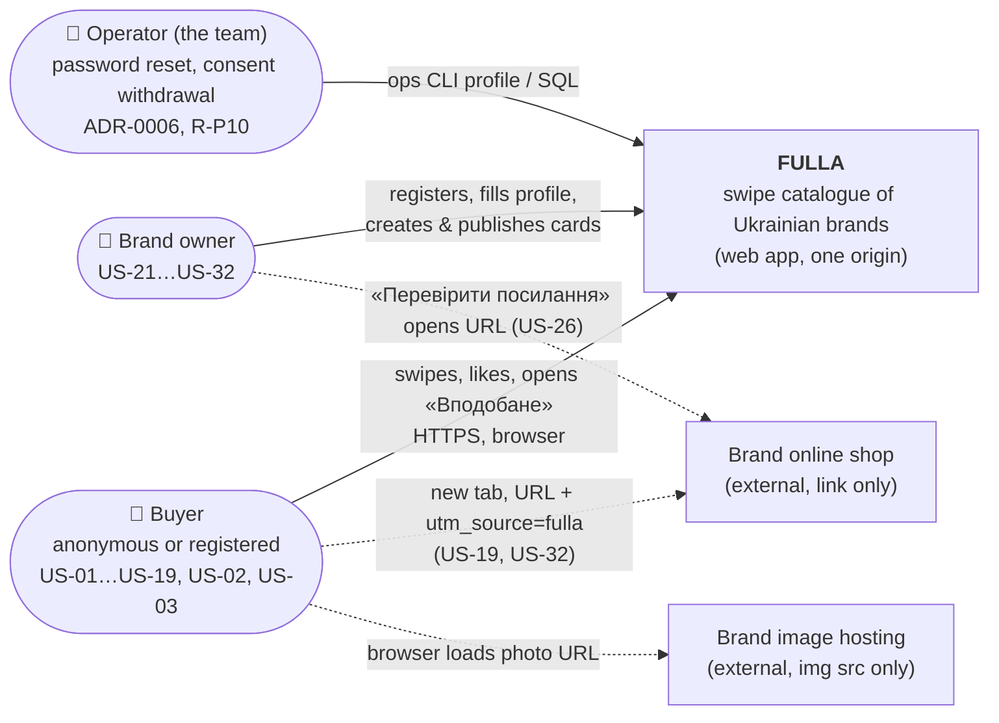
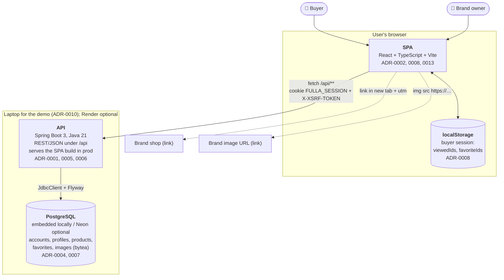

# FULLA — System Overview (MVP)

**Audience:** a new team member who needs the whole picture in 10 minutes.
**Sources:** [`requirements-digest.md`](../analysis/requirements-digest.md), [ADR-0001…0013](../adr/README.md), [`integrations.md`](integrations.md), the 19 MVP stories in [`user stories/`](../../user%20stories/UserStoriesREADME.md).
**Companion documents:** [`domain-model.md`](domain-model.md) (entities, rules, state machines) · [`api.md`](api.md) (HTTP contract) · [`data-model.md`](data-model.md) (DB schema) · [`system.html`](system.html) (the same thing as one visual page).
**Status:** sketch, 28.10.2026. No code exists yet; every name below is a target, not a description of existing code.

---

## 1. What FULLA is, in one paragraph

A buyer opens a link on a phone, swipes through clothing cards from Ukrainian brands (right = «Подобається», left = «Пропустити»), collects likes in «Вподобане», and goes to the brand's own shop with `utm_source=fulla` to buy. No account is needed; an optional account moves «Вподобане» to the server. A brand owner registers, fills in a name, gives consent, creates product cards by hand, previews them, and publishes them to the feed. FULLA has no cart, no payment and no integration with brand sites (US-32).

## 2. C4 level 1 — system context

Solid arrows are calls into FULLA. Dashed arrows are **links**: the user's browser goes there; the FULLA server never calls them (A-15, `integrations.md`).

## 3. C4 level 2 — containers

In development, Vite (port 5173) serves the SPA and proxies `/api` to Spring (port 8080), so the browser still sees one origin (ADR-0010). Server sessions are in memory: a restart logs everyone out (ADR-0006).

## 4. Components of each container

### 4.1. SPA (`frontend/src/`, ADR-0001, ADR-0008)

| Component | Responsibility |
|---|---|
| `features/start` | Start page with the 3-step mechanic and «Почати шопінг» (US-01.1, US-01.2). |
| `features/feed` | Shows the first unviewed published card, handles swipe/buttons, shows the "all viewed" state (US-08.1, US-09, US-10). |
| `features/feed/session.ts` | Buyer session store `{ viewedIds, favoriteIds }`, persisted in localStorage and synced between tabs (US-01.2 S2, US-09 S2). |
| `features/favorites` | «Вподобане» list with live card data and the brand-site button (US-16, US-19). |
| `features/buyer-auth` | Buyer register/login/logout and the favourites merge (US-02, US-03). |
| `features/cabinet-auth` | Brand register/login/logout and the redirect to login (US-21, US-21.1). |
| `features/cabinet-profile` | Brand name, logo and consent form (US-22.1, US-22.2). |
| `features/cabinet-products` | Product list, card form, preview, publish/unpublish (US-25.1, US-25.2, US-26, US-31). |
| `shared/ui/ProductCard` | The one card renderer used by the feed, «Вподобане» and the brand preview (NFR-17). |
| `shared/links.ts` → `withUtm()` | The only builder of outbound links; adds `utm_source=fulla` (US-19, US-32). |
| `shared/messages.uk.ts` | Ukrainian UI text for every API error code (ADR-0005). |
| `shared/validation.ts` | zod form schemas that mirror the backend rules for instant feedback (R-T17). |
| `api/client.ts`, `api/types.ts` | Typed `fetch` wrapper (CSRF header, error envelope, 401 redirect) and types written by hand from `api.md`. |

### 4.2. API (`backend/src/main/java/ua/fulla/`, ADR-0001)

Each feature package is `XController → XService → XRepository`. A package uses another one only through its service.

| Package | Responsibility |
|---|---|
| `common` | Error envelope (`@RestControllerAdvice`), Spring Security config (roles, CSRF, session cookie), `GET /api/session` (Q-10), SPA forward for non-API paths. |
| `brandauth` | Brand registration, login and logout; creates the empty profile on registration (US-21, US-21.1). |
| `brandprofile` | Read/save the brand name, logo and consent; consent is one-way (US-22.1, US-22.2, A-08). |
| `products` | Card CRUD for drafts, publish/unpublish gate, the only place that changes card status (US-25.1, US-26, US-31). |
| `feed` | Public reads: the published feed and "cards by IDs" with `available` (US-08.1, US-16, US-19). |
| `images` | Upload checked by magic bytes and served with immutable cache, behind `ImageStore` (ADR-0007). |
| `buyer` | Buyer accounts and the idempotent favourites endpoint (US-02, US-03, ADR-0012). |
| `ops` (profile `ops`) | Operator commands: `reset-password`, consent withdrawal with unpublish-all (ADR-0006, R-P10). |
| dev seeder (profile `dev`) | Fills an empty DB with ≥ 4 brands and ~30 cards for the demo (ADR-0004, R-P04). |

### 4.3. PostgreSQL (ADR-0004)

| Table | Responsibility |
|---|---|
| `brand_accounts` | Brand login identity (email + BCrypt hash). |
| `brand_profiles` | Brand name, logo, consent record; 1:1 with the account. |
| `products` | Product cards with status Draft/Published. |
| `images` | Uploaded logo and photo bytes. |
| `buyer_accounts` | Optional buyer login identity. |
| `favorites` | Registered buyers' liked product IDs. |

Details: [`data-model.md`](data-model.md).

### 4.4. localStorage (browser)

| Key | Responsibility |
|---|---|
| buyer session (one key, versioned) | `viewedIds` and `favoriteIds` of this browser; the only buyer state for anonymous buyers (A-09, ADR-0008). |

## 5. Frontend pages → stories

Routes are from ADR-0008.

| Route | Page | Stories |
|---|---|---|
| `/` | Start page | US-01.1, US-01.2, US-16 (navigation) |
| `/feed` | Swipe feed | US-01.2, US-08.1, US-08.2, US-09, US-10, US-03 (liked cards hidden) |
| `/favorites` | «Вподобане» | US-16, US-19, US-32, US-02 (call to action) |
| `/register` | Buyer registration | US-02 |
| `/login` | Buyer login | US-03 |
| `/brand/register` | Brand registration | US-21 |
| `/brand/login` | Brand login | US-21.1 |
| `/brand/profile` | Brand profile and consent | US-22.1, US-22.2 |
| `/brand/products` | Brand product list, publish/unpublish | US-21.1 S1, US-25.1, US-31 |
| `/brand/products/:id` | Card form + preview (`:id = new` for a new card, see Q-09) | US-25.1, US-25.2, US-26, US-31 |

Buyer logout is a button in the buyer navigation, which is on `/`, `/feed` and `/favorites` only (US-16 CL). Brand logout is a button in the cabinet header (US-21.1).

## 6. External systems: integrations vs links

**The MVP has no API integration with any third party.** The FULLA server never sends a request to a brand site (A-15).

| External system | Kind | Who talks to it | Stories |
|---|---|---|---|
| Brand online shop (product page) | **Link only**: URL stored as entered, `utm_source=fulla` added in the browser, opened in a new tab | Buyer's / brand's browser | US-19, US-26, US-32 |
| Brand image hosting (`https://` photo or logo URL) | **Link only**: ``, placeholder on error | Browser | US-08.2, US-22.1, US-25.1, US-25.2 |
| PostgreSQL (embedded / Neon) | **Real dependency**, infrastructure | API | all |
| Render | Infrastructure, optional step, not used for the demo | — | ADR-0010 |
| GitHub, Maven Central, npm | Dev-time only | Developers, CI | ADR-0011 |

## 7. End-to-end scenario (the demo path)

| # | Actor | Action | API | Story |
|---|---|---|---|---|
| 1 | Brand | Registers with email + password ≥ 8 | `POST /api/brand/register` | US-21 |
| 2 | Brand | Saves brand name (logo optional) → may create cards | `PUT /api/brand/profile` | US-22.1 |
| 3 | Brand | Ticks consent → may publish | `PUT /api/brand/profile` | US-22.2 |
| 4 | Brand | Uploads a photo, saves draft "Лляна сукня міді", 2400, URL | `POST /api/images`, `POST /api/brand/products` | US-25.1, US-26 |
| 5 | Brand | Opens preview (no status change) | — (client only) | US-25.2 |
| 6 | Brand | «Опублікувати у стрічку» → Published | `POST /api/brand/products/{id}/publish` | US-31 |
| 7 | Buyer | Opens `/`, presses «Почати шопінг» | `GET /api/feed` | US-01.1, US-01.2 |
| 8 | Buyer | Swipes right → card in «Вподобане», counter +1 | — (localStorage) | US-09 |
| 9 | Buyer | Opens «Вподобане» | `GET /api/products?ids=…` | US-16 |
| 10 | Buyer | Registers; local likes move to the account | `POST /api/buyer/register`, `POST /api/me/favorites` | US-02 |
| 11 | Buyer | «Перейти на сайт бренду» → new tab `…?utm_source=fulla` | — (link) | US-19, US-32 |

## 8. Decisions at a glance

One line per ADR; the ADR is the source. All 13 are **Proposed** (see Q-01 about "nine").

| ADR | Decision | Main consequence |
|---|---|---|
| [0001](../adr/0001-architecture-style.md) | React SPA built into the Spring Boot app, one origin; package-by-feature | One obvious place per story; contract agreed before wiring |
| [0002](../adr/0002-platform-responsive-web.md) | One responsive, mobile-first web app; one `ProductCard` | Preview = feed card by construction; swipe needs care on iOS |
| [0003](../adr/0003-repository-structure.md) | One repo: `backend/`, `frontend/`, hand-written `docs/contracts/api.md` | Nothing generated; FE types can drift (R-T12) |
| [0004](../adr/0004-postgres-embedded-neon-jdbcclient.md) | Postgres (embedded locally, Neon optional) + Flyway + `JdbcClient` | Invariants are visible SQL; more mapping code than JPA |
| [0005](../adr/0005-backend-spring-boot-rest.md) | Spring Boot 3 / Java 21, REST, Bean Validation, one error envelope | UI texts keyed by error code; rules written twice |
| [0006](../adr/0006-auth-spring-security-sessions.md) | Spring Security, BCrypt, in-memory sessions, one cookie, CSRF on | A restart logs everyone out; one account type per browser |
| [0007](../adr/0007-image-storage-in-db.md) | Uploaded images as `bytea` behind `ImageStore`; URLs kept as-is | Same everywhere, no account; DB quota to watch |
| [0008](../adr/0008-frontend-stack.md) | Vite, React Router, TanStack Query, Zustand + localStorage, `motion`, zod | Each hard part is a library feature |
| [0009](../adr/0009-consistency-and-concurrency.md) | DB or pure functions enforce invariants; UI only mirrors them | Holds across tabs and direct API calls |
| [0010](../adr/0010-deployment-and-hosting.md) | Local demo; Render + Neon documented as optional | No hosting work; demo depends on one laptop |
| [0011](../adr/0011-quality-and-tooling.md) | Minimal CI: `mvnw verify` + lint, typecheck, Vitest | Contract drift caught by review and MockMvc JSON tests |
| [0012](../adr/0012-buyer-accounts-favorites-sync.md) | Optional buyer account; only «Вподобане» moves to the server, merged by union | Idempotent single endpoint; progress stays per device |
| [0013](../adr/0013-frontend-language-typescript.md) | TypeScript `strict` | A code without a Ukrainian text fails `tsc` |

---

## 9. Open questions

Things found while designing that the stories or ADRs do not settle, or settle in two different ways. Each has a **proposal used in these documents**; none of them is decided. The team lead (stories) or the ADR owner should close them.

| ID | Question | Where it conflicts | Proposal used in this sketch |
|---|---|---|---|
| Q-01 | **The task brief does not match this repository.** It names "DevMatch", state machines for *Project, Role, Application* and "the nine decisions". This repo is FULLA: there are no such entities, and there are 13 ADRs (and D0–D10 in `options.md`). | Task brief vs `requirements-digest.md`, `docs/adr/` | The three state machines are FULLA's three lifecycle entities: **Brand Profile, Product Card, Card Impression**. `system.html` shows **all 13 ADRs**. Please confirm the brief was meant for FULLA. |
| Q-02 | **Where does the API contract live?** ADR-0003/0005 say `docs/contracts/api.md` is the contract that changes with each controller. This task creates `docs/architecture/api.md`. Two files = drift (R-T12). | ADR-0003, ADR-0005 | Treat `architecture/api.md` as the **draft** that becomes `docs/contracts/api.md` in week 1 (move it, don't copy it). |
| Q-03 | **Is `POST /api/images` public?** ADR-0006 makes "everything else under `/api`" public, which includes the upload. Then anyone can store 5 MB blobs in the DB (Neon 0.5 GB quota, R-T04). Only brands upload images in any story. | ADR-0006 vs ADR-0007, US-22.1, US-25.1 | `POST /api/images` requires `ROLE_BRAND`; `images.uploaded_by` records the brand; a card/profile may only reference its own brand's images. `GET /api/images/{id}` stays public. |
| Q-04 | **403 or 404 for another brand's card?** ADR-0005 says 403 "not owner (INV-07)". ADR-0006 says every query filters by the owner's ID, so a foreign card is simply "not found". Both can't be true without an extra query. | ADR-0005 vs ADR-0006 | **404 `NOT_FOUND`** (also hides which IDs exist). 403 is used only for wrong role and CSRF. |
| Q-05 | **Skipped on one device, liked on another.** Digest INV-05 says Skipped ∩ Favorites = ∅. After a login merge (US-03), a card skipped on this device can arrive in favourites from another device. | INV-05 vs US-03 S1, ADR-0012 | Favourites win: the card is shown in «Вподобане»; INV-05 holds per device only until a merge. Rewrite INV-05 in the digest. |
| Q-06 | **Logout before a failed like is re-synced.** ADR-0012 keeps an unsynced like locally and re-sends it later; US-03 CL clears local favourites on logout. A like that failed to sync is lost on logout. | ADR-0012 vs US-03 CL | Logout first re-sends the local set (`POST /api/me/favorites`), then logs out; if that fails, warn the buyer before clearing. |
| Q-07 | **US-19 S2 cannot happen as written.** It assumes a saved product with an empty or non-http URL, but US-26 makes saving such a card impossible. ADR-0009 reuses the same inactive button for *unpublished* cards (`available=false`). | US-19 S2 vs US-26 CL, ADR-0009 | Keep the defensive URL check in `withUtm`/`ProductCard`; rewrite US-19 S2 with the real trigger: "the brand unpublished the item". |
| Q-08 | **Missing UI texts for rejected input.** No story gives the Ukrainian text for: password < 8 chars (US-21, US-02), product name empty or > 100 (US-25.1), image upload > 5 MB or wrong type in the *card* form, card creation without a brand name. `messages.uk.ts` needs one text per code (ADR-0008). | US-21, US-02, US-25.1, US-22.1 | New codes `PASSWORD_TOO_SHORT`, `CARD_INVALID_NAME`, `IMAGE_INVALID`, `PROFILE_INCOMPLETE` (see `api.md` §3); texts to be written by the designer/lead. Until then, `IMAGE_INVALID` shows the US-22.1 S2 text in the profile form and the US-25.1 S2 text in the card form. |
| Q-09 | **No route for a new card.** ADR-0008 lists `/brand/products/:id` (edit + preview) but nothing for "Додати товар" (US-25.1 S1). | ADR-0008 vs US-25.1 | `/brand/products/new` renders the same page with an empty form. |
| Q-10 | **No "who am I" endpoint.** Buyer navigation must show "login" or "logout" on every buyer screen (US-16 CL); the cabinet must redirect to login when there is no session (US-21.1 CL); Spring Security's CSRF cookie must be issued before the first `POST`. ADR-0005's list has no endpoint for this. | ADR-0005 vs US-16, US-21.1 | Add `GET /api/session` → `{ accountType: "BRAND" \| "BUYER" \| null, email }`; it also sets `XSRF-TOKEN`. |
| Q-11 | **Price upper bound and BCrypt limit are unnumbered.** A-13 says "a sane upper bound" for price; BCrypt ignores bytes after 72, so a 100-char password "works" with any suffix. | A-13, US-25.1, NFR-03 | Price 1…1 000 000 UAH; password 8…72 characters. |
| Q-12 | **"Complete profile activation" in US-22.2 S2.** It says the system blocks "completing profile activation" without consent, but US-22.1 CL says a saved name already makes the profile *active*, and saving without consent is allowed. | US-22.2 S2 vs US-22.1 CL, A-05 | Saving the profile without consent succeeds (state Active); only **publishing** is blocked with `CONSENT_REQUIRED`. Reword US-22.2 S2 to "publish". |
| Q-13 | **Rate limit is not in the error format.** ADR-0006 limits login/register to ~10/min per IP, but no story or ADR names the response. | ADR-0006 vs ADR-0005 | `429 TOO_MANY_REQUESTS` with the standard envelope; text to be written. |
